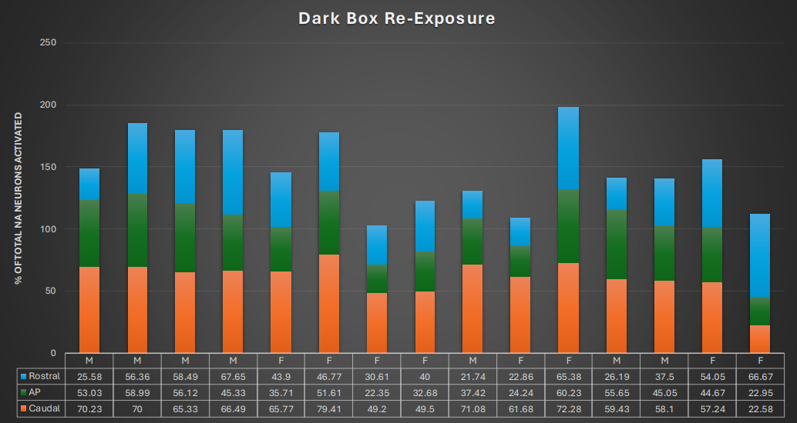
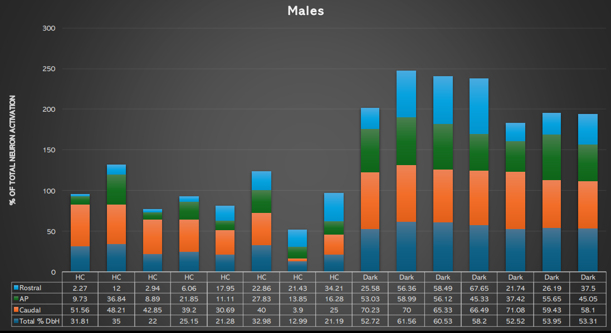
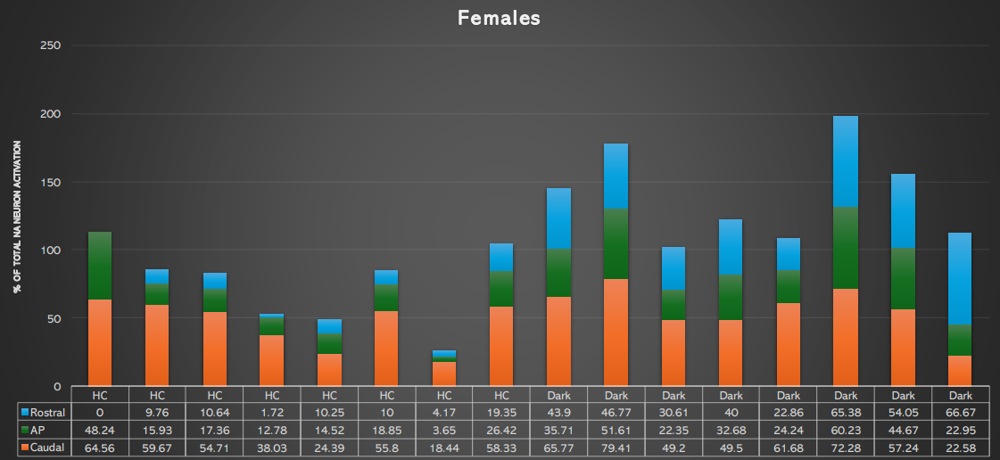
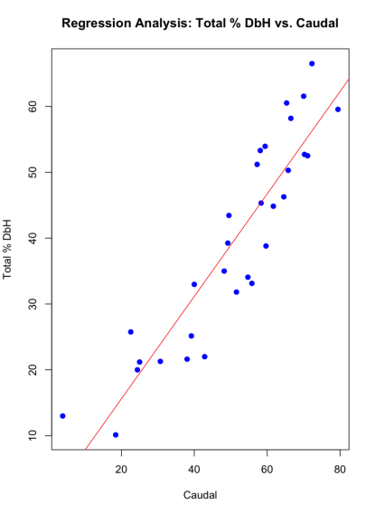
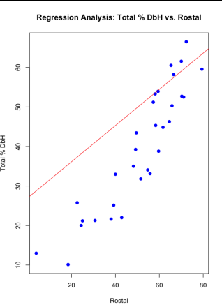
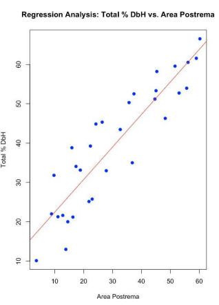

# Activation Patterns of A2 Noradrenergic Neurons in Fear-Conditioned Rats

## Project Overview

This repository contains the R code and datasets for analyzing the activation of A2 noradrenergic neurons in the nucleus of the solitary tract (NTS) of rats subjected to fear conditioning. The study focuses on dopamine β-hydroxylase (DbH) neurons, examining differences in activation under various conditions.

## Research and Data Origin

### Data Collection

The experimental data for this study on A2 noradrenergic neuron activation were collected at Florida State University by the research team there. These experiments focused on understanding the neurological responses of rats subjected to various environmental conditions. For more details on the experimental setup and methodologies, refer to the published article linked below:

Research Article on ScienceDirect

### Data Analysis

The data analysis was conducted by Gitika Bhardwaj and Tyla Dolezel at Rush University, utilizing the R programming language. We applied statistical methods including group comparisons, regression modeling, and a power analysis to examine the activation of dopamine β-hydroxylase (DbH) neurons under fear conditioning stimuli.

## Project Structure

```
/images/    Generated figures
/data/      Contains instructions and links for accessing the datasets used in the analyses.
            Data collection was performed at Florida State University, with further details
            and findings available in the linked research article.
/scripts/   Contains the R script developed for data processing, analysis, and visualization.
            The statistical analysis was carried out at Rush University.
/results/   Includes output files and visualizations generated from the R script.
```

## Data Description

The data is derived from experimental observations on rat neuron activation under different environmental exposures. Key variables include:

- `Total_DbH`: Percentage of DbH activation.
- `Re_exposure`: Environmental condition ('Dark' or 'Home Cage').

### Files and Directories

- `DbH.csv`: Dataset with the experimental results.
- `analysis.R`: R script for statistical analysis and generating visualizations.

## Requirements

This project uses R with packages like ggplot2, dplyr, and tidyr. Install them using:

```r
install.packages(c("ggplot2", "dplyr", "tidyr"))
```

## Usage

To run the analysis:

1. Ensure that R and all required packages are installed.
2. Execute the script via command line:

```
Rscript analysis.R
```

## Key Findings

### Group Comparison

DbH neuron activation was higher in the Dark re-exposure group than in the Home Cage group, and the difference was statistically significant (p < 0.0001). The effect was observed in a comparison of activation levels across the two environmental conditions.

### Power Analysis

A power analysis estimated the study's ability to detect an effect of the observed size at 0.899, meaning the probability of a Type II error (failing to detect a true effect where one exists) was low for this comparison. Power was assessed for the group comparison only; it does not extend to the region-level regression below, which was fitted on a small number of observations.

### Descriptive Statistics and Roles in Neuron Activation

#### Re-Exposure

The following graph shows the percentage of neuron activation in the dark box re-exposure scenario, highlighting differences between male and female subjects.



#### By Sex

These separate graphs for males and females show how the neuron activation response differed between the sexes under the same environmental stimulus.

 | 

### Regression Analysis

The series of graphs produced from regression analysis show how neuron activation relates to counts in different brain regions:

- **Caudal region:** the strongest of the three regional predictors of overall neuron activation.
- **Rostral and AP regions:** weaker predictors, but still contributing to the model.

 |  | 

#### Model Notes

The regression model has a multiple R-squared of 0.9774. A value this high on a small dataset usually reflects the number of predictors relative to the number of observations as much as it reflects the strength of the underlying relationship, so the coefficient is best read as describing these data rather than as an estimate that would transfer to another sample. The regional predictors should be treated as candidate relationships worth testing on a larger dataset.

## Limitations

- The experimental data were collected at Florida State University; this repository covers the analysis, not the data collection.
- The dataset is small, and the region-level regression was fitted with multiple predictors on a limited number of observations.
- The findings describe DbH activation in this cohort of animals under these specific conditions and should not be generalised beyond them without replication.
- The variables available here (activation percentage, re-exposure condition, brain region) do not include covariates such as age, sex distribution per group, or handling history, which may affect activation.

## Future Directions

- **Longitudinal effects:** examine the effects of repeated exposure to fear-inducing environments on neuron activation, to see whether the response changes with repeated exposure.
- **Genetic influences:** investigate genetic factors that may influence the activation of A2 noradrenergic neurons.
- **Cross-species analysis:** extend the analysis to other species to test whether the patterns observed here hold more broadly.
- **Integration with behavioural measures:** combine these activation data with behavioural analyses to examine how changes in neuron activation relate to behaviour.
- **Measurement methods:** apply newer approaches for measuring neuron activation to refine the accuracy of the data.

## Acknowledgements

We thank the research teams at Florida State University for conducting the experiments that form the basis of this analysis. Their work made this analysis possible. Special thanks to Tyla Dolezel for her contributions to the research at Florida State University and to the statistical analysis at Rush University.

## Contact

For more information, potential collaborations, or discussion of the analysis, feel free to reach out:

Email: gita.bhardwaj1@gmail.com

```
